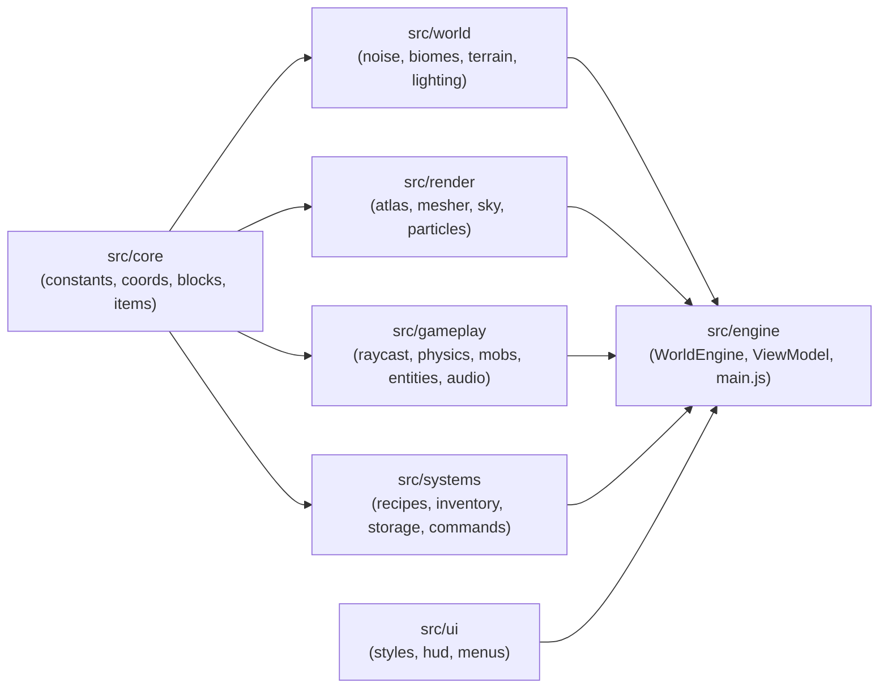

# 🏗️ CraftScape — System Architecture

> 📌 **Architecture Style:** Clean modular ES2024 engine separating immutable **Core Contracts** (`src/core`), **World & Light** (`src/world`), **Voxel Renderer** (`src/render`), **Gameplay Physics & Entities** (`src/gameplay`), **Crafting/Inventory/Storage** (`src/systems`), **Clean HUD/Menus** (`src/ui`), and the **Game Loop Spine** (`src/engine`).

---

## 📋 Document Properties

| Property | Value |
| :--- | :--- |
| **Rendering Pipeline** | Three.js `0.175.0` WebGL2 (`MeshLambertMaterial` / vertex colors + single 256×256 Canvas Atlas) |
| **Chunk Dimensions** | `16 × 128 × 16` (`32,768` bytes blocks + `32,768` bytes packed light) |
| **Chunk Meshing** | Neighbor-aware face culling + Per-Vertex Smooth AO + Split Opaque/Cutout Buffers |
| **Coordinate Layout** | Y-major voxel indexing: `idx = (ly * 16 + lz) * 16 + lx` |

---

## 🧭 System Diagram

---

## 📦 Module Ownership Matrix

| Layer | Files | Responsibility |
| :--- | :--- | :--- |
| **Core** | `constants.js`, `coords.js`, `blocks.js`, `items.js` | Shared block/item IDs, tool speeds, chunk geometry math. |
| **World** | `noise.js`, `biomes.js`, `terrain.js`, `lighting.js` | Seeded Simplex/FBM terrain, 5 biomes, caves, ores, BFS sky+block lighting. |
| **Render** | `atlas.js`, `mesher.js`, `sky.js`, `particles.js` | Procedural 16×16 pixel atlas + icons, smooth AO chunk mesher, day/night sky, VFX particles. |
| **Gameplay** | `raycast.js`, `physics.js`, `mobs.js`, `entities.js`, `audio.js` | DDA raycasting, swept AABB + sneak/fly/swim, articulated mobs, drops & TNT, Web Audio SFX. |
| **Systems** | `recipes.js`, `inventory.js`, `storage.js`, `commands.js` | 2×2/3×3 recipes, furnace ticks, chests, survival stats, IndexedDB saves, `/` commands. |
| **UI** | `styles.css`, `hud.js`, `menus.js` | Minimal HUD, hotbar, F3 telemetry, crafting/furnace/chest modal, title & pause menus. |
| **Engine** | `src/engine/WorldEngine.js`, `src/engine/ViewModel.js`, `src/main.js` | Streaming chunk manager, dirty light/mesh rebuild queue, pointer lock, 60 FPS loop. |

---

## 🔦 Lighting & Smooth AO Data Flow

1. Each chunk stores `light = new Uint8Array(32768)` where high nibble `(val >> 4) & 0xf` is **Sky Light** (`0..15`) and low nibble `val & 0xf` is **Block Light** (`0..15`, e.g., Torch = `14`, Lava = `14`, Glowstone = `15`).
2. `computeChunkLighting` casts vertical sky rays down until opaque blocks hit, then runs bounded BFS flood-fill into caves and outward from emissive blocks.
3. During meshing (`mesher.js`), each exposed face computes 4 corner Ambient Occlusion levels (`0..3`), combines directional sun shade + sky/block light into RGB vertex colors, and flips the quad diagonal whenever `ao0 + ao2 > ao1 + ao3` to eliminate diagonal shading creases.
