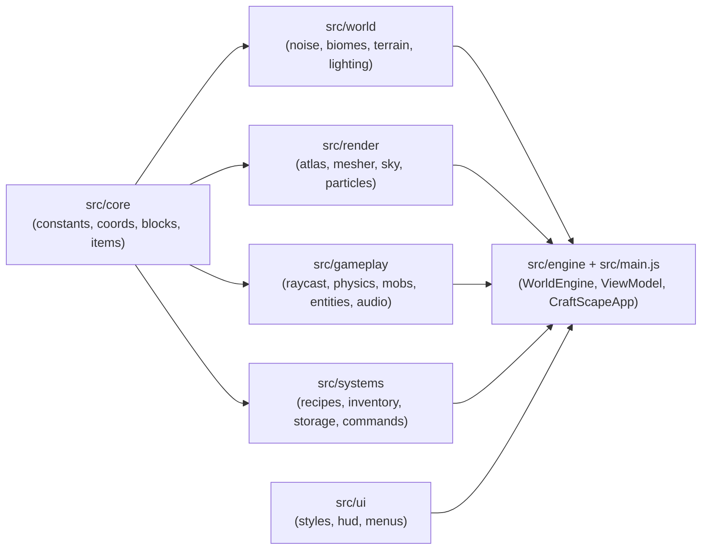

# 🧱 CraftScape — Clean 3D Voxel Sandbox

> 📌 **Summary:** **CraftScape** is a clean, high-craft Minecraft-inspired 3D voxel sandbox built in Pure ES2024 JavaScript and Three.js (`0.175.0`). It features deterministic multi-biome terrain, smooth per-vertex ambient occlusion, skylight + cave torchlight propagation, Survival & Creative game modes, 2×2 / 3×3 crafting + Recipe Book, smelting furnaces, chests, primed TNT craters, articulated mobs, procedural Web Audio SFX, and IndexedDB multi-world persistence — with zero external texture/audio dependencies.

---

## 📋 Project Properties

| Property | Value |
| :--- | :--- |
| **Project Name** | CraftScape (`craftscape`) |
| **Repository** | [`KARTHIKEYASHARMA672/craftscape`](https://github.com/KARTHIKEYASHARMA672/craftscape) *(Public · `main`)* |
| **Stack** | Pure ES2024 JavaScript (`type: "module"`) · Three.js `0.175.0` · Vite `6.x` · Vitest `3.x` · ESLint `9.x` |
| **World Scale** | `16 × 128 × 16` chunks · `SEA_LEVEL = 42` · Default `5`-chunk radius (`11×11` active grid) |
| **Game Modes** | **Survival** (health, hunger, oxygen, tool durability/speeds) · **Creative** (flight, instant break, catalog) |
| **Verification** | `eslint` (`0` errors/`0` warnings) · `vitest` (`5` files, `60/60` passed) · Headless Chromium WebGL2 (`1280×720`, `0` console/HTTP/page errors) |

---

## 🧭 Table of Contents

- [✨ Core Features](#-core-features)
- [🎮 Controls & Slash Commands](#-controls--slash-commands)
- [🏗️ Architecture Overview](#️-architecture-overview)
- [🚀 Getting Started](#-getting-started)
- [🧪 Verification & Quality Checks](#-verification--quality-checks)

---

## ✨ Core Features

| Domain | Implemented Capabilities |
| :--- | :--- |
| **World Generation** | Seeded Simplex/FBM terrain across 5 biomes (**Plains**, **Forest**, **Desert**, **Snowy Peaks**, **Lush Valley**), oceans/lakes at `Y = 42`, carving caves, Coal/Iron/Gold/Diamond/Redstone ores, Bedrock at `Y = 0`, Oak/Birch/Spruce trees, cacti, sugar cane, and flowers. |
| **Voxel Lighting & Meshing** | `Uint8Array` packed `Sky (0..15) \| Block (0..15)` BFS lighting (`Torch`, `Lava`, `Glowstone`), neighbor-aware face culling, split opaque/cutout/water buffers, custom GLSL atmospheric/fog chunk shader, and diagonal-flipped Smooth Ambient Occlusion (`0..3`). |
| **Sky & Particles** | Continuous Day/Sunrise/Sunset/Night orbital Sun & Moon, twilight fog matching, twinkling starfield, drifting instanced clouds, block-break debris, torch embers, and explosion bursts. |
| **Physics & Interaction** | Accurate 3D DDA voxel raycasting (`5.5` reach), wireframe highlight & 10-stage mining cracks, swept AABB collision, edge-safe crouching, `2×W`/`R`/`Ctrl` sprinting with FOV kick, water swimming/buoyancy, fall damage, and Creative double-tap `Space` flight. |
| **Crafting, Smelting & Storage** | `37` recipes (`2×2` pocket grid + `3×3` Crafting Table) with interactive **Recipe Book**, real-time **Stone Furnace** smelting + fuel meter, **27-slot Chests** (that drop contents if broken), and `IndexedDB` multi-world save/load + `30s` auto-save. |
| **Mobs & Entities** | Articulated **Sheep**, **Cow**, **Pig**, **Zombie** (daylight burning + hostile pursuit), and **Creeper** (fuse telegraph + crater blast), plus spinning magnetic item drops and flintless `RMB` Primed **TNT**. |
| **Procedural Assets** | Crisp 256×256 procedural pixel atlas (`NearestFilter` + UV inset), isometric 3D HUD/slot icons, depth-cleared First-Person Viewmodel, `[F5]` Third-Person Explorer Rig, and procedural Web Audio SFX. |

---

## 🎮 Controls & Slash Commands

| Action | Input |
| :--- | :--- |
| **Move / Strafe** | `W` `A` `S` `D` |
| **Jump / Swim / Creative Fly** | `Space` *(double-tap `Space` in Creative toggles flight)* |
| **Sprint / Sneak (Edge-Guard)** | `R`, `2×W`, or `Ctrl` latch / `Shift` or `C` |
| **Mine / Attack Mob** | `LMB` *(hold to mine in Survival; hit mobs within `4.2` blocks)* |
| **Place / Interact / Light TNT / Eat** | `RMB` *(hold `Shift` + `RMB` to place blocks onto Crafting Table/Furnace/Chest)* |
| **Pick Block / Drop Item** | `MMB` or `P` / `Q` |
| **Select Hotbar Slot** | `1–9` keys or Mouse Wheel |
| **Inventory / Recipe Book / Catalog** | `E` |
| **Slash Commands** | `T` or `/` |
| **Telemetry / Perspective / Pause** | `F3` (Telemetry) · `F5` (1st/3rd Person) · `Esc` (Pause & Settings) |

### Supported Slash Commands
- `/help` or `/?` — Lists available commands
- `/gamemode <survival|creative>` (alias `/gm`) — Switches game mode live
- `/time set <day|sunrise|noon|sunset|night|midnight|0..1>` — Changes time of day immediately
- `/tp <x> <y> <z>` — Teleports player (supports relative `~` offsets)
- `/give <item> [count]` — Grants any item or block (`1..640`)
- `/seed` — Displays current world seed
- `/heal` — Restores health, hunger, and oxygen to full
- `/clear` — Clears player inventory

---

## 🏗️ Architecture Overview



See also: [`PRD.md`](./PRD.md) · [`ARCHITECTURE.md`](./ARCHITECTURE.md) · [`DESIGN.md`](./DESIGN.md) · [`RULES.md`](./RULES.md) · [`PHASES.md`](./PHASES.md)

---

## 🚀 Getting Started

```bash
# 1. Install dependencies
npm install

# 2. Start development server
npm run dev

# 3. Build production bundle & preview locally
npm run build
npm run preview
```

---

## 🧪 Verification & Quality Checks

| Check | Command | Verified Result |
| :--- | :--- | :--- |
| **Static Linting** | `npm run lint` (`eslint src tests`) | ✅ `0` errors, `0` warnings |
| **Unit & Integration Tests** | `npm test` (`vitest run`) | ✅ `5` files, `60/60` tests passed (`world`, `mesher`, `gameplay`, `systems`, `integration`) |
| **Production Build** | `npm run build` (`vite build`) | ✅ Clean `dist/` bundle (`31` modules in `1.87s`) |
| **Live WebGL2 Browser Audit** | Playwright Chromium `1280×720` on `http://127.0.0.1:4173/` | ✅ `0` console/HTTP/page errors, `57` preloaded chunks, `190` FPS title telemetry, WASD + `/time` + `/gamemode` + `[F3]` + `[F5]` + `[E]` Recipe Book (`37` recipes) & Creative Catalog (`47/47` icons) + `[Esc]` Pause + IndexedDB Save/Load verified |
